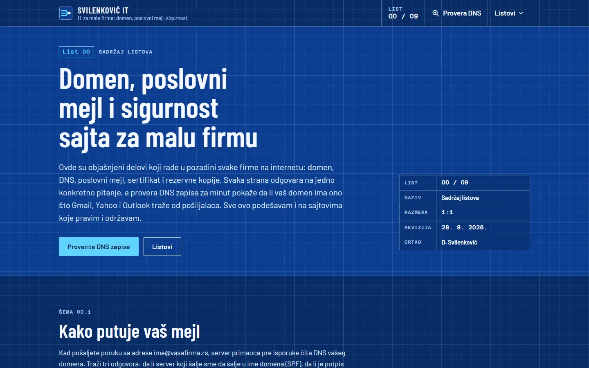
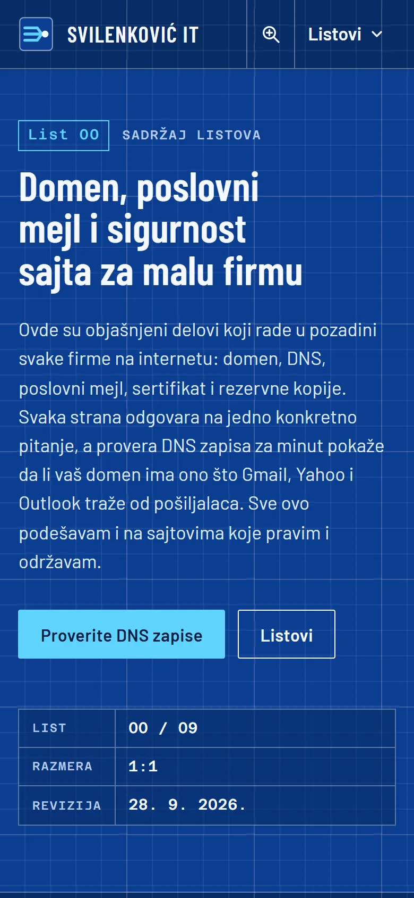
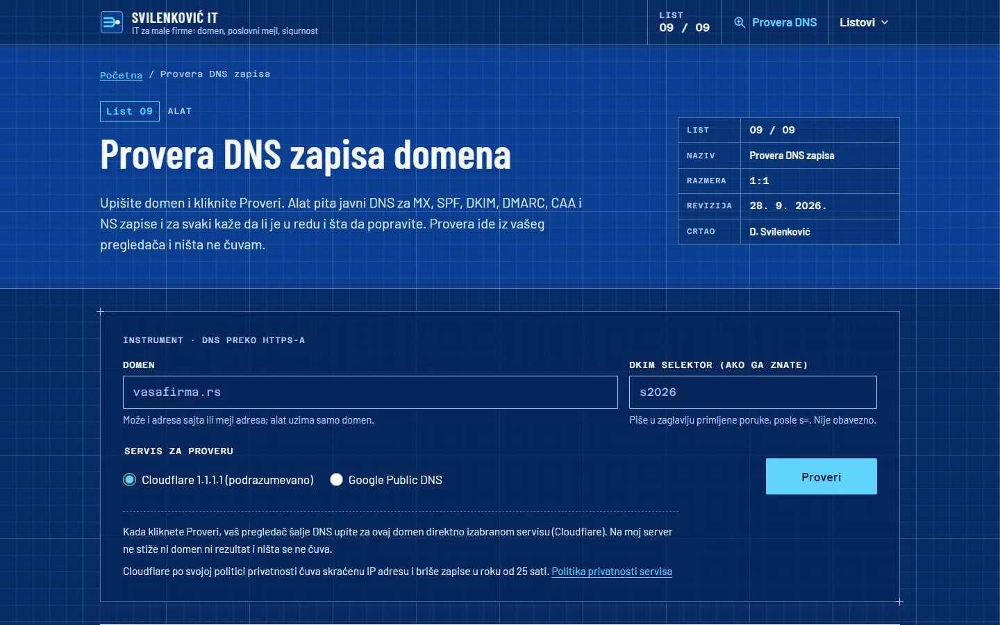

# Svilenković IT

Plain explanations of domains, DNS, business email and certificates, with a DNS checker that runs in the visitor's browser.

**[svilenkovicit.com](https://svilenkovicit.com/)** · [Case study (in Serbian)](https://svilenkovic.rs/radovi/svilenkovic-it) · [Srpski](README.sr.md)

> [!NOTE]
> My own project, not client work. The source code is private. This page describes what the site does and how it is built.

<table>
  <tr><td><b>Client</b></td><td>Own project</td></tr>
  <tr><td><b>Industry</b></td><td>Domains, business email and website security</td></tr>
  <tr><td><b>Location</b></td><td>Serbia</td></tr>
  <tr><td><b>Type</b></td><td>Multi-page website with a DNS checker</td></tr>
  <tr><td><b>My role</b></td><td>Research, design, development, SEO and hosting</td></tr>
  <tr><td><b>Stack</b></td><td>Astro 7, GSAP, DNS-over-HTTPS, PHP 8.3, SQLite, nginx</td></tr>
</table>

## About the project

Small businesses usually think about their domain and email only when messages start landing in spam or the domain expires. Svilenković IT explains the parts that run in the background, written for the owner and not for an administrator. Each page is drawn as one sheet of a technical drawing, with a sheet number, scale and revision date, and answers one question, from mail going to spam to what to do after a hack.

The DNS checker asks public DNS for NS, A, AAAA, MX, SPF, DKIM, DMARC, CAA and DNSSEC and explains each finding in Serbian. Queries go over DNS-over-HTTPS straight from the visitor's browser to Cloudflare or Google, so neither the domain nor the result reaches my server, and the content security policy allows connections only to those two services.

## What I built

- A DNS checker that also catches an SPF record over the ten-lookup limit, two SPF records on one domain and outdated DMARC tags
- A diagram of one email's path, drawn with GSAP, where a forged message fails SPF, DKIM and DMARC
- GSAP loaded only when the diagram scrolls into view, with the finished drawing shown without scripts or with reduced motion
- Separate pages for the domain, DNS, business email, certificates, backups and a hacked site
- A contact form with validation and a rate limit

## Results

| | Performance | Accessibility | Best practices | SEO |
| :-- | :-: | :-: | :-: | :-: |
| Mobile | 100 | 100 | 100 | 100 |
| Desktop | 100 | 100 | 100 | 100 |

PageSpeed Insights, lab test of the live site, October 2026. Security headers: 6 of 6. HTML validator: no errors. axe accessibility check: no violations. Structured data: `FAQPage`, `Person`.

## Screenshots

<table>
  <tr>
    <td width="68%" valign="top"></td>
    <td width="32%" valign="top"></td>
  </tr>
</table>

DNS checker with a verdict for each record

---

Built by [D. Svilenković](https://svilenkovic.com).
